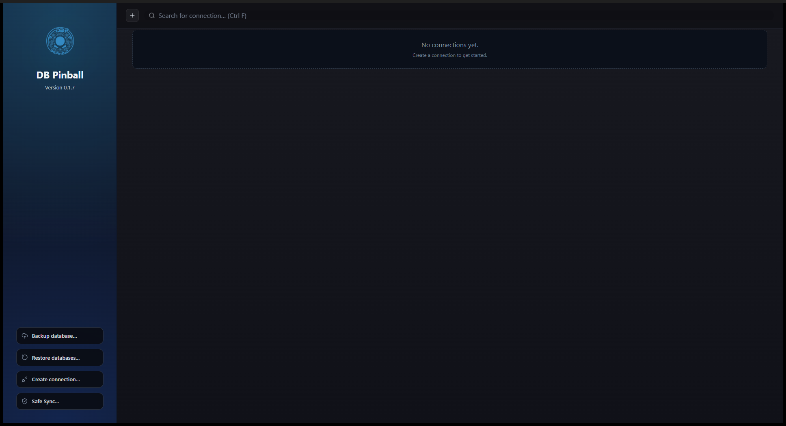
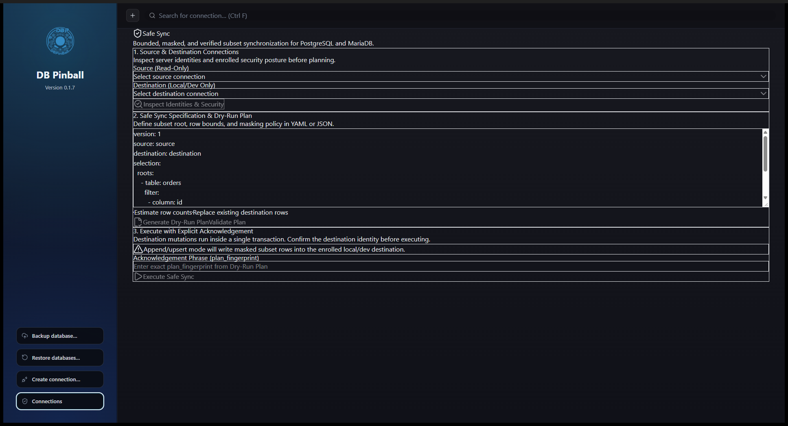

# DBPinball

**Inspect databases and reproduce production data safely — desktop app and CLI.**

[](LICENSE)
[](https://github.com/programinglive/dbpinball/releases/latest)
[](https://github.com/programinglive/dbpinball/actions/workflows/ci.yml)

DBPinball is an open-source tool for PostgreSQL and MariaDB. It inspects
databases, verifies that a destination is safe to write to, and copies a
bounded, masked subset of production data into a local development database
through a signed, reviewable plan. It ships as a desktop application and as a
standalone `dbpinball` command-line interface over the same Rust core.

- **Download:** [latest release](https://github.com/programinglive/dbpinball/releases/latest)
- **Documentation:** <https://dbpinball.programinglive.com>
- **Installation guide:** <https://dbpinball.programinglive.com/guide/installation>



## Why DBPinball

- **Local-first.** Connection profiles and credentials stay on your machine;
  passwords live in the operating system keyring, never in a file.
- **Safe by construction.** Safe Sync refuses to write to a destination it
  cannot verify, refuses to read from a source that is not read-only, and fails
  closed on anything it cannot classify.
- **One core, two surfaces.** The CLI and the desktop app call the same Rust
  service, so a plan reviewed in the UI behaves exactly like one run from a
  terminal.
- **Reviewable plans.** A plan is a value-free document bound by an HMAC. You
  review it, acknowledge its fingerprint, and only then does anything write.

## Supported engines

| Engine | Versions tested | Inspection | Safe Sync |
| --- | --- | --- | --- |
| PostgreSQL | 11+ | Yes | Yes |
| MariaDB | 10.11 | Yes | Yes, on InnoDB base tables |
| MySQL (non-MariaDB) | 5.7+, 8.0+ | Yes | **Refused** |

Safe Sync requires MariaDB specifically: a server that identifies itself as
MySQL is refused rather than treated as compatible. MariaDB 10.11 is the version
the integration suite runs against; older MariaDB releases are not tested.

## What it does

| Capability | Desktop | CLI |
| --- | --- | --- |
| Connection vault with OS keyring credentials | Yes | `connections` |
| Database and table inspection | Yes | `schema inspect` |
| SQL workspace with write authorization | Yes | — |
| Destination verification and security policy | Yes | `security` |
| Safe Sync: inspect, plan, validate, execute, status | Yes | `safe-sync` |
| Environment diagnostics | — | `doctor` |

### Safe Sync

Safe Sync copies a **bounded, masked subset** of a production database into a
local development database.

1. **Inspect** the source and destination identities.
2. **Plan** a selection: root tables, typed filters, parent-directed foreign-key
   traversal, row and byte limits, and a masking policy.
3. **Validate** the plan against the live catalogue and the security policy.
4. **Execute** inside one transaction, with an explicit acknowledgement of the
   plan fingerprint.
5. **Verify** the destination digest, and retry idempotently if a run was
   interrupted.

It refuses, rather than guesses, when it meets a non-InnoDB table, a trigger, an
unsupported column type, a foreign-key cycle, a destination that is not enrolled
as local, a plan whose signature does not match, or a masking strategy that is
not implemented.



## Install

### Windows 10/11 (x64)

1. Download `dbpinball_0.1.7_x64-setup.exe` from the
   [latest release](https://github.com/programinglive/dbpinball/releases/latest).
2. Run it. It installs for the current user, so it does not ask for
   administrator rights, and it creates a Start Menu entry and an uninstaller.

The CLI is a separate download. Extract `dbpinball-cli-0.1.7-x64.zip` and run:

```powershell
powershell -ExecutionPolicy Bypass -File .\install-cli.ps1
```

That installs to `%LOCALAPPDATA%\dbpinball\bin` and adds the folder to your user
`PATH`, so a new terminal resolves `dbpinball` with no manual editing.

### Linux (x64)

```bash
sudo apt install ./dbpinball_0.1.7_amd64.deb
# or run the AppImage without installing
chmod +x dbpinball_0.1.7_amd64.AppImage && ./dbpinball_0.1.7_amd64.AppImage
```

The CLI tarball contains a single binary:

```bash
tar -xzf dbpinball-cli-0.1.7-x64-linux.tar.gz
sudo install -m 0755 dbpinball /usr/local/bin/dbpinball
```

### Verify the installation

```bash
dbpinball --version
dbpinball doctor
dbpinball --help
```

Every release publishes `SHA256SUMS-windows.txt` and `SHA256SUMS-linux.txt`.
Verify a download before running it.

## Quick start

```bash
# Store a connection; the password is read from stdin and kept in the keyring
dbpinball connections add --name local-dev --engine postgres \
  --host 127.0.0.1 --port 5432 --database app --username postgres --target local

# Inspect it
dbpinball connections list --json
dbpinball schema inspect --connection <id> --json

# Plan a masked subset, review the plan, then execute it
dbpinball safe-sync inspect --source <id>
dbpinball safe-sync plan --spec sync.yaml --out plan.json
dbpinball safe-sync validate --plan plan.json --spec sync.yaml
dbpinball safe-sync execute --plan plan.json --spec sync.yaml --ack <plan_fingerprint>
```

## Security model

- **Source is read-only.** The source session is opened read-only at the
  database level, and a role that can write is refused.
- **Destination is verified.** A destination must be enrolled as local; its
  identity fingerprint is bound into the plan, so a connection that claims to be
  local but points elsewhere is refused.
- **Plans are signed.** The plan carries an HMAC over its content, issuance time
  and expiry. Editing it, re-dating it, or running it with a rotated key fails.
- **Masking is deterministic and keyed.** The same value masks to the same
  output across tables, so foreign keys survive, and the key never leaves the
  keyring.
- **Fail closed.** Anything the tool cannot classify is refused, not copied.

Report vulnerabilities privately — see [SECURITY.md](SECURITY.md). Do not open a
public issue for a security problem.

## Supported platforms

| Platform | Desktop | CLI | Status |
| --- | --- | --- | --- |
| Windows 10/11 (x64) | Installer | Zip + `install-cli.ps1` | Built, installed, launched and uninstalled in acceptance |
| Linux (x64) | `.deb`, AppImage | Tarball | Packages built and content-verified; a real install and launch was not executed |
| macOS | — | — | Not packaged |

**The Windows binaries are not code-signed.** SmartScreen warns that the
publisher is unknown, and heuristic scanners can quarantine an unsigned binary.
Verify the published SHA-256 before running. Code signing is a separate
operational improvement.

## Known limitations

- Backup, restore and copy exist as Tauri commands but are **not routed in the
  current UI**, and the CLI has no backup command. Do not rely on them.
- The internal dumper fallback (used when `mysqldump`/`pg_dump` is missing)
  creates an empty file and reports success.
- The desktop adapter builds connection URLs by string interpolation in the query
  connection helpers and the fallback dumpers, so a password containing `@`,
  `:`, `/`, `?` or `#` can produce a malformed URL, and a database error may echo
  it. Restore uses `PGPASSWORD`/`MYSQL_PWD`, and Core Safe Sync is not affected.
- The `useSsl` flag is stored but not applied to connections.
- `deterministic_phone`, `date_shift`, `amount_jitter` and `fixed` are declared
  in the masking policy schema but not implemented, and are refused.
- Non-MariaDB MySQL is refused for Safe Sync.

## Contributing

Contributions are welcome. Read [CONTRIBUTING.md](CONTRIBUTING.md) for the
environment, the test commands and the pull-request workflow, and
[CODE_OF_CONDUCT.md](CODE_OF_CONDUCT.md) for community expectations.

```bash
npm ci
cargo test --workspace
npm test
```

Security-sensitive changes (credentials, connection handling, SQL execution,
masking, destination verification) need a test that proves the control.

## Project status

Pre-1.0. The latest release is **v0.1.7**. The core, CLI and desktop surfaces are
implemented and tested; the limitations above are known and documented rather
than hidden. Interfaces may change before 1.0.

## License

MIT — see [LICENSE](LICENSE). Third-party attributions are recorded in
[THIRD_PARTY_NOTICES.md](THIRD_PARTY_NOTICES.md).
