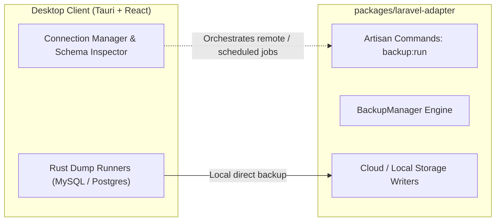

# DB Pinball — Laravel Adapter Integration

This document outlines the architecture and role of the Laravel Adapter package (`packages/laravel-adapter`), formerly maintained as the standalone repository `programinglive/laravel-simple-backup`.

---

## 1. Architecture Overview

`dbpinball` functions as a unified database utility suite:



1. **Desktop Client (`src-tauri` + `src/`)**: Provides the interactive TablePlus-style GUI for developers to inspect databases, test queries, and execute ad-hoc local backups using native Rust runners.
2. **Laravel Adapter (`packages/laravel-adapter/`)**: Provides the PHP package for Laravel applications (`illuminate/support`, `illuminate/console`) to automate database dumps, gzip compression, and retention pruning on server environments.

---

## 2. Using the Adapter in Laravel Projects

The adapter package can be referenced directly from this monorepo or installed as a composer path repository:

```json
{
  "repositories": [
    {
      "type": "path",
      "url": "path/to/dbpinball/packages/laravel-adapter"
    }
  ],
  "require": {
    "programinglive/laravel-simple-backup": "*"
  }
}
```

Or published to Packagist/GitHub Packages under `@programinglive/dbpinball-laravel-adapter`.

### Available Artisan Commands
- `php artisan backup:run`: Runs database dump according to `config/backup.php`.
- `php artisan backup:clean`: Cleans old database archives exceeding retention policies.
